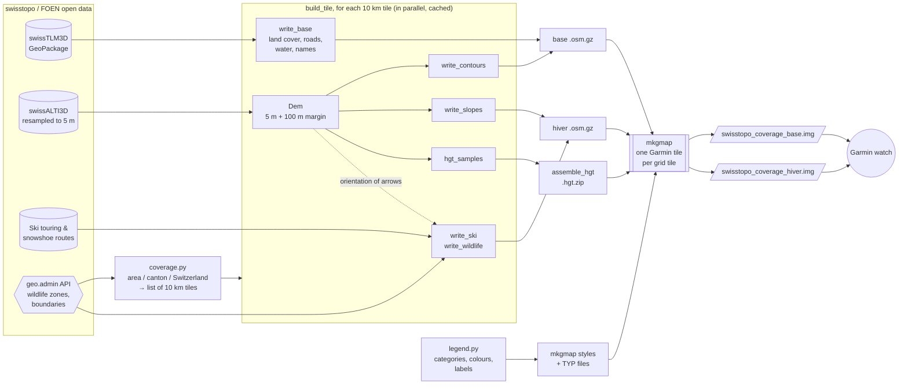

# swisstopo-garmin

Build lightweight **vector maps for Garmin watches and handhelds** (tested target: fēnix 7X Pro) from the
**free geodata of swisstopo**, with a **winter overlay** for ski touring: slope classes over 30°,
ski touring and snowshoe routes, and wildlife quiet zones.

It was written for mountain leaders and ski tourers who need a map that sticks to the
Swiss national map content in summer as well as in winter. Maps can cover a small area, one or several
cantons, all of Switzerland, **French departments** (Haute-Savoie, the Pyrenees) built from the open
data of IGN, OpenStreetMap and Camptocamp, and, built from OpenStreetMap, the national open terrain
models and Camptocamp:
- the **Italian Alps** along the Swiss border down to the Gran Paradiso;
- the **Austrian Alps** and the **Allgäu** (Bavaria);
- the **Spanish Pyrenees** and **Andorra**.

Swiss data always has priority, then French data, then the other countries: each one only fills the area
outside the countries before it, and the terrain is seamless across the borders. The Alps and the
Pyrenees make two maps (`alpes`, `pyrenees`) that can be installed together.

| Map | Content | When to use it |
|---|---|---|
| `swisstopo_<coverage>_base.img` | Contour lines (10/50/100 m), rock, scree, glaciers, forest, water, buildings, roads, paths with the Swiss hiking colours (yellow / red / blue), aerial ropeways, summits with elevation, passes, huts, place names, hill shading | All year |
| `swisstopo_<coverage>_hiver.img` | Transparent overlay: slope classes 30-35° / 35-40° / 40-45° / > 45°, ski touring network with uphill/downhill arrows, "on foot" and "increased caution" sections, route numbers with SAC grade, snowshoe routes, wildlife quiet zones and protection areas with their allowed routes | Winter |

Outside Switzerland the content is as close as the open data allows:

| | Switzerland | France | Italy, Austria, Allgäu, Spain, Andorra |
|---|---|---|---|
| Terrain, contours, slopes, hill shading | swissALTI3D | IGN RGE ALTI 5 m | Italy: INGV TINITALY 10 m; Austria: DGM Österreich 10 m; Allgäu: Bavarian DGM1 (1 m, averaged to 5 m); Spain: IGN MDT 5 m; Andorra: Copernicus 30 m |
| Land cover, roads, paths, water, buildings, names | swissTLM3D | IGN BD TOPO | OpenStreetMap |
| Rock and scree areas | swissTLM3D | OpenStreetMap | OpenStreetMap |
| Hiking paths | Swiss hiking categories (yellow / red / blue) | BD TOPO routes: GR in red, other routes in yellow | Swiss colours from the OpenStreetMap SAC scale, trail number as label |
| Ski touring routes | swisstopo / SAC network | Camptocamp: track when available, otherwise a point with the route name and grade | Camptocamp, as in France, and the ski touring routes mapped in OpenStreetMap |
| Wildlife | Quiet zones and protection areas (FOEN) | Nature reserves, protection orders and wildlife reserve (BD TOPO), without periods | National and regional parks, nature reserves (OpenStreetMap), without rules |

Vector maps are much smaller than raster maps of the same area and stay sharp at every zoom level: a
mountain area of 400 km² takes about 6 MB (base and winter overlay together).

> ⚠️ **Safety.** The slope layer is computed from the terrain model and does not replace the avalanche
> bulletin, the official maps or your own judgement in the field. Check the quiet zones and their dates on
> [map.geo.admin.ch](https://map.geo.admin.ch) before each trip.

---

## How it works



1. **`coverage.py`** turns a coverage into a list of tiles of a fixed **10 km × 10 km LV95 grid**. A coverage
   can be a named area, one or several cantons, all of Switzerland, French departments or zones of the
   countries mapped from OpenStreetMap. Canton and country outlines come from the geo.admin API, French
   departments from geo.api.gouv.fr, Italian provinces from ISTAT, and the Austrian, German and Spanish
   NUTS 3 regions and Andorra from Eurostat (GISCO). Each tile has a fixed Garmin map id derived from its position, so a tile built
   once is reused by every coverage that contains it.
2. **`download.py`** fetches the data from the swisstopo STAC API:
   - the swissALTI3D tiles needed by the coverage, resampled to 5 m right away (the 2 m originals would
     take ~40 GB for Switzerland);
   - the full swissTLM3D and the ski touring and snowshoe route datasets;
   - the French departments and the other countries' zones touching the coverage (see `france.py`,
     `osmzone.py` and `demsrc.py`);
   - **mkgmap**, the open-source Garmin map compiler.

   Downloads resume if interrupted.
3. **`build.py`** builds every tile in parallel, then compiles the coverage. A tile that is already built is
   not built again.
   - The tile is converted to **OSM XML** (gzipped, WGS84). Each object is tagged with a single key
     `k=<category>`.
   - The terrain model is read with a 100 m margin, so contour lines and slope areas match across tile
     edges. It feeds the contour lines, the slope classes, the samples used for hill shading and the
     orientation of the ski arrows: each arrowed segment is reoriented uphill or downhill.
   - Wildlife zones come live from the geo.admin API, together with the routes allowed inside them.
   - An opaque background, called `land`, covers Switzerland only. On the device, the map therefore
     hides Garmin's own maps (TopoActive) in Switzerland, but lets them show through abroad.
4. **`legend.py`** is the single source of truth for the look of the maps. For every category it holds
   the Garmin type, the zoom level, the colours or bitmap pattern, and the legend labels in FR/DE/IT/EN.
   From it, the build writes the **mkgmap style** (which `k=` goes to which Garmin type) and the **TYP
   file** (how the device draws each type).
5. **mkgmap** compiles each grid tile into a Garmin tile. All tiles of a coverage are bundled into one `.img`
   per map: the base map with its elevation model for hill shading, and the winter overlay drawn on top
   of it.

### Files

| File | Role |
|---|---|
| `config.py` | Settings: paths and options from `.env`, tile size, named areas and Garmin family ids, dataset URLs |
| `coverage.py` | Tile grid, Garmin map ids, zone outlines, resolution of a coverage (area, canton, Switzerland, department, zone, alias, bbox) into tiles |
| `download.py` | Downloads and resamples swissALTI3D, downloads swissTLM3D, the ski/snowshoe routes, the French departments, the other countries' zones and mkgmap |
| `france.py` | French departments: download (BD TOPO, RGE ALTI, OpenStreetMap, Camptocamp) and conversion to the map categories |
| `countries.py` | Zones of the countries mapped from OpenStreetMap: outline, Geofabrik extract and terrain model of each zone |
| `osmzone.py` | Those zones: OpenStreetMap download and classification, Camptocamp routes, conversion to the map categories |
| `demsrc.py` | Terrain models outside Switzerland and France (Austria, Bavaria, Spain, Copernicus), converted to 5 m LV95 km² files |
| `italy.py` | Italian terrain model (TINITALY) |
| `build.py` | Pipeline: per-tile terrain model, contours, slopes, base data, winter data, hill shading, mkgmap call |
| `legend.py` | Map legend: Garmin types, zoom levels, colours/patterns, translated labels; generates style and TYP |
| `gui.py` | Configuration window: zones picked on a map, options, download and build with their log |
| `i18n.py` | Translations of the window (texts are written in French in `gui.py`) |
| `zones.py`, `zones.json` | Names and simplified outlines of the zones shown in the window (`python zones.py` regenerates the outlines) |
| `osmwriter.py` | Writes shapely geometries (LV95) to OSM XML (WGS84), including multipolygons with holes |
| `.env.example` | Template of the local configuration (copy to `.env`) |
| `requirements.txt` | Python dependencies |
| `packaging/` | Standalone application: `build_app.py` (build script), PyInstaller recipe, entry point |
| `.github/workflows/package.yml` | Builds the application for Windows and macOS and attaches it to the releases |

Data stays outside the repository, in `DATA_DIR`:

```
DATA_DIR/
├── download/
│   ├── alti3d_5m/         swissALTI3D at 5 m, one file per km² (~85 KB/km², ~3.5 GB for Switzerland)
│   ├── swisstlm3d_…/      swissTLM3D (≈ 11 GB unzipped)
│   ├── rgealti_5m/        RGE ALTI reprojected to LV95, 5 m, one file per km²
│   ├── fr/<dept>/         BD TOPO, OpenStreetMap rock, Camptocamp routes, outline of the department
│   ├── tinitaly_5m/, dgm_at_5m/, dgm_by_5m/, mdt_es_5m/, copdem_5m/
│   │                      terrain of Italy, Austria, Bavaria, Spain, elsewhere: LV95, 5 m, one file per km²
│   ├── it|at|de|es|ad/<zone>/  OpenStreetMap objects, Camptocamp routes, outline of the zone
│   ├── it/istat/, gisco/  ISTAT and Eurostat boundaries
│   └── …                  route datasets, Switzerland outline
├── work/
│   ├── tiles/<E>-<N>/     per tile: base and winter OSM, elevation samples, status (shared by coverages)
│   └── coverages/<name>/  hgt files, generated style and TYP, mkgmap output
└── output/                final .img files
```

---

## Ready-to-use application

The [releases](https://github.com/dustag/garmin-swisstopo/releases) have an application for Windows and
macOS that holds everything it needs (Python, the libraries, Java and mkgmap): nothing to install.

- **Windows**: unzip `swisstopo-garmin-<version>-windows-x64.zip` anywhere and start
  `swisstopo-garmin\swisstopo-garmin.exe`. The application is not signed: on the first start, Windows
  SmartScreen may show a warning, click **More info** then **Run anyway**.
- **macOS 15 (Sequoia) or later**: open `swisstopo-garmin-<version>-macos-arm64.dmg` (Apple silicon: M1
  and later) or `swisstopo-garmin-<version>-macos-x64.dmg` (Intel) and drag the application to
  **Applications**. It is not signed by Apple: on the first start, macOS refuses to open it; go to
  **System Settings > Privacy & Security** and click **Open Anyway**.

The data is downloaded to `swisstopo-data` in the home folder (about 20 GB for all of Switzerland), the
folder can be changed in the window. Everything below is only needed to work on the code.

---

## Installation

Requirements: **Python ≥ 3.11**, **Java ≥ 11** (for mkgmap), about **20 GB** of free disk space and an
internet connection.

```powershell
git clone https://github.com/dustag/garmin-swisstopo.git
cd garmin-swisstopo
python -m venv .venv
.venv\Scripts\activate            # Linux/macOS: source .venv/bin/activate
pip install -r requirements.txt
copy .env.example .env           # Linux/macOS: cp .env.example .env
```

Edit `.env`:

| Variable | Meaning | Default |
|---|---|---|
| `DATA_DIR` | Where data is downloaded and processed. Keep it out of OneDrive/Dropbox. | `~/swisstopo-data` |
| `OUTPUT_DIR` | Where the final `.img` files go | `$DATA_DIR/output` |
| `TOOLS_DIR` | Where mkgmap is unpacked | `./tools` |
| `JAVA_EXE` | Java executable, if `java` is not in the PATH | `java` |
| `JAVA_MAX_HEAP` | Memory for mkgmap | `4g` |
| `COVERAGE` | Default coverage (see below) | `telliers` |
| `LANG_LABELS` | Language of the labels: `fr`, `de`, `it` or `en` | `fr` |
| `FRANCE_DEPTS` | French departments whose data is used, comma-separated | `74,64,65,31,09,66` |
| `ITALY_ZONES` | Italian zones whose data is used: provinces by their abbreviation, and `GP` for the Piedmont side of the Gran Paradiso | `AO,VB,VA,CO,SO,BZ,GP` |
| `AUSTRIA_ZONES` | Austrian NUTS 3 regions whose data is used | the 19 regions of the Alps, from Vorarlberg to Lower Austria |
| `GERMANY_ZONES` | German NUTS 3 regions whose data is used | `DE27E,DE27A,DE273` (Allgäu) |
| `SPAIN_ZONES` | Spanish NUTS 3 provinces whose data is used | `ES220,ES241,ES513,ES512` (Navarre, Huesca, Lleida, Girona) |
| `ANDORRA_ZONES` | Andorra, or nothing | `AD` |

### Configuration window

```powershell
python gui.py
```

Click the cantons, French departments and zones of the other countries to put in the map (wheel to zoom,
drag to move); the Pyrenees are drawn in a framed inset below the Alps, not at their true distance.
Then
choose the maps (summer base map, winter overlay or both), the label language and the folders, then **Construire les cartes**: the window runs `download.py`
and `build.py` and shows their log. The window is in the language chosen for the labels (French, German, Italian or
English; at first start, the system language, or English), and the choices are remembered for the next time. The departments and
zones picked on the map are added to `FRANCE_DEPTS`, `ITALY_ZONES`, `AUSTRIA_ZONES`… for that build.

### Command line

```powershell
python download.py        # first run: ≈ 5 GB (swissTLM3D) + elevation tiles of the coverage, resumable
python build.py
```

Both scripts take the coverage from `.env` or from `--coverage`. `build.py` has more options:

```powershell
python build.py --coverage canton:VS     # build another coverage
python build.py --no-dem                 # no hill shading (smaller map)
python build.py --maps hiver             # only the winter overlay (base, hiver or both)
python build.py --step osm               # only build the tiles
python build.py --step mkgmap            # only compile (after editing legend.py, for example)
python build.py --force                  # rebuild the tiles even if already built
python build.py --jobs 4                 # number of tiles built in parallel (default: CPU cores - 1)
```

The maps are written to `OUTPUT_DIR`, for example `swisstopo_telliers_base.img` and
`swisstopo_telliers_hiver.img`.

### Coverages

| Coverage | Example | Map name on the device | Family id |
|---|---|---|---|
| Named area of `config.AREAS` | `telliers`, `chavornay` | `Swisstopo base telliers` | set in `AREAS` (6530, 6532…) |
| All of Switzerland and Liechtenstein | `switzerland` | `Swisstopo base suisse` | 6520 |
| One or several cantons | `canton:VS`, `canton:VS,VD` | `Swisstopo base vs-vd` | 6600 + 2 × canton index |
| One or several French departments | `dept:74` | `Swisstopo base fr74` | 6700 + 2 × department number |
| One or several Italian zones, or all of `ITALY_ZONES` | `it:AO,GP`, `it` | `Swisstopo base itao-gp` | 6800 + 2 × (ISTAT province code % 100) |
| Austrian, German or Spanish zones, Andorra, or all the zones of a country | `at:AT334`, `at`, `de`, `es:ES241`, `ad` | `Swisstopo base at334` | 9000 + 2 × (hash of the codes % 1000) |
| The Alps (`switzerland+dept:74+it+at+de`) or the Pyrenees (`dept:64,65,31,09,66+es+ad`) | `alpes`, `pyrenees` | `Swisstopo base alpes` | as for `+` |
| Any rectangle (LV95 metres) | `bbox:2570000,1080000,2600000,1100000` | `Swisstopo base custom` | 6590 |
| Several of the above, joined with `+` | `canton:VS+dept:74` | `Swisstopo base vs+fr74` | 7000 + 2 × (hash of the coverage % 1000) |

Orders of magnitude: Switzerland is about 500 tiles, Valais about 80, Haute-Savoie about 70, the default
Italian zones about 290, the Austrian Alps about 560, the Pyrenees about 850. Built tiles are
cached, so after the first build a legend change only needs `--step mkgmap`.

A French department is downloaded the first time a coverage touches it, if it is listed in
`FRANCE_DEPTS` (≈ 600 MB to download per department; among the downloads, the Camptocamp routes take a few minutes because the
API is queried gently). Tiles on the border then contain both countries; tiles built before the
department was available are rebuilt automatically.

Italian zones work the same way with `ITALY_ZONES`. The default zones are the provinces bordering
Switzerland (Aosta, Verbano-Cusio-Ossola, Varese, Como, Sondrio, Bolzano) and `GP`, the six municipalities
of the Gran Paradiso in the province of Turin (Valle Orco, Valle Soana), so that the whole massif is
covered without the plain of Turin. Their download takes about 1.5 GB: two OpenStreetMap extracts of
Geofabrik, read once and deleted, and the TINITALY terrain tiles, converted and deleted.

Austria, the Allgäu, Spain and Andorra work the same way. Their downloads:

| Country | OpenStreetMap | Terrain |
|---|---|---|
| Austria | 815 MB | DGM Österreich 10 m, one file of 1.9 GB |
| Allgäu | 130 MB | Bavarian DGM1, ≈ 8 GB of 1 km tiles, averaged to 5 m as they arrive |
| Spain | 40-270 MB per region | IGN MDT 5 m, read from its WCS service by blocks of 0.1° (≈ 10 MB each) |
| Andorra | 4 MB | Copernicus GLO-30 |

The sources are deleted once converted. A coverage that does not touch Switzerland, such as `pyrenees`,
does not download the Swiss data.

For the Alps and the Pyrenees:

```powershell
python download.py --coverage alpes
python build.py --coverage alpes
python download.py --coverage pyrenees
python build.py --coverage pyrenees
```

To add a named area, add an entry to `AREAS` in `config.py` with an unused **even** family id and the
bounding box in LV95 metres (read the coordinates on [map.geo.admin.ch](https://map.geo.admin.ch)):

```python
AREAS = {
    "telliers":  (6530, (2_574_000, 1_079_000, 2_584_000, 1_088_000)),
    "chavornay": (6532, (2_531_000, 1_170_000, 2_539_000, 1_177_000)),
    "arolla":    (6534, (2_600_000, 1_088_000, 2_612_000, 1_100_000)),
}
```

The bounding box is rounded up to whole 10 km tiles.

Maps of different coverages can be installed side by side, as long as they don't overlap. Don't install
two coverages sharing tiles, for example `telliers` and `canton:VS`, or `canton:VS` and `dept:74` (they
share the border tiles), at the same time: they contain the same Garmin tiles. Build one combined coverage
instead, such as `canton:VS+dept:74`.

### Labels and languages

- **Legend** (category names shown by the device): the TYP file contains French, German, Italian and
  English, and the watch picks the one matching its language. `LANG_LABELS` sets the fallback string.
- **Data labels** (SAC grade of routes, type of allowed route in a wildlife zone) follow `LANG_LABELS`.
- **Place names** always keep their official local form from swissTLM3D. Elsewhere, bilingual names of
  OpenStreetMap (South Tyrol, Aosta Valley, Basque Country, Catalonia…) are replaced by the name in the
  label language when there is one.

Changing `LANG_LABELS` rebuilds the tiles automatically on the next run.

### Building the application

```powershell
pip install -r packaging/requirements.txt
python packaging/build_app.py
```

The script needs a JDK 21 or newer for `jlink` (`JAVA_HOME`, `jlink` in the PATH, or `JAVA_EXE` of `.env`).
It downloads mkgmap, makes a minimal Java runtime with the modules mkgmap uses, bundles everything with
PyInstaller and writes the archive of the current platform to `dist/`, with the version of `CHANGELOG.md`.
Intermediate files go to the temporary folder (`APP_BUILD_DIR` to change it), out of synced folders.

PyInstaller only builds for the platform it runs on. The GitHub workflow `.github/workflows/package.yml`
builds Windows, macOS for Apple silicon and macOS for Intel when a release is published, and attaches the
three archives to it; it can also be run
by hand from the Actions tab.

---

## Installing the maps on a Garmin watch

The steps below were written for a **fēnix 7X Pro**. Other recent Garmin devices (Epix, Forerunner with
maps, eTrex, GPSMAP…) work the same way, with slightly different menu names.

### 1. Copy the files

1. Connect the watch to the computer with its USB cable.
2. Open the device storage:
   - **Windows**: in the File Explorer, the watch appears under *This PC* as `fēnix 7X Pro` (MTP device,
     no drive letter). Open `Internal Storage`.
   - **macOS**: install [OpenMTP](https://openmtp.ganeshrvel.com/) (Garmin Express does not copy custom
     maps) and open the watch storage.
   - **Linux**: the watch is mounted through MTP (gvfs/`jmtpfs`).
3. Copy the `.img` files into the **`GARMIN`** folder at the root of the storage:
   ```
   Internal Storage/
   └── GARMIN/
       ├── swisstopo_telliers_base.img
       └── swisstopo_telliers_hiver.img
   ```
   Keep distinct file names. Do **not** rename the files `gmapsupp.img`, which could overwrite another map.
4. Eject the watch properly and unplug it. It scans the new maps on restart, which can take a few
   seconds.

The maps then appear in hold **MENU** → **Map** → **Map Manager**.

### 2. Enable the maps per activity (summer / winter)

On the fēnix 7X Pro, the Map Manager only lets you delete maps. Maps are enabled or disabled **for each
activity**:

1. Hold **MENU**.
2. Select **Activities & Apps** → choose the activity → **Activity Settings** → **Map**.
3. Select **Configure Maps** and toggle each installed map on or off for that activity.

This is also how you switch seasons:

| Activity | Swisstopo base | Swisstopo hiver | TopoActive |
|---|---|---|---|
| Summer: *Hike*, *Mountaineering*… | on | off | **off** |
| Winter: *Backcountry Ski*, *Snowshoe*… | on | on | **off** |

Turn TopoActive off in these activities: otherwise it may be drawn instead of the Swisstopo map. Don't
delete it from the Map Manager, since it remains useful in other activities and abroad.

### 3. Recommended map settings

Hold **MENU** → **Map**:

| Setting | Value | Why |
|---|---|---|
| Map Theme | **None** | Other themes replace the colours of the TYP file |
| Detail | **More** or **Most** | Shows the 10 m contour lines and the small paths earlier |
| Relief Shading | **On** | Uses the elevation model embedded in the base map |
| Orientation | to taste (North up is closest to a paper map) | |

### 4. Updating or removing

To update a map, overwrite the `.img` files in `GARMIN` with the new versions; to remove it, delete them.
A new version of the data (swissTLM3D is published every year, the ski routes several times a season)
only requires running `download.py` and `build.py --force` again.

### Troubleshooting

| Symptom | Cause / fix |
|---|---|
| The map does not appear in the Map Manager | File outside the `GARMIN` folder, or watch not restarted. Check the extension is `.img`. |
| Garmin map shows instead of this one (no hiking trails in yellow / red / blue, no cream background) | TopoActive still enabled for the activity: turn it off in *Configure Maps* |
| Colours look like the Garmin map | Map Theme not set to *None* |
| Slope stipple hides the terrain | Turn the winter overlay off for the activity, or change `STIPPLE` in `legend.py` to a sparser pattern |
| No 10 m contour lines or labels | They only appear at the closest zoom levels; set Detail to *More* or *Most* |
| Two coverages look mixed up | They share tiles (for example an area and its canton): install only one of them |

---

## Data sources and licences

The **code** is licensed under the [GNU GPL v3 or later](LICENSE): you may use, modify and share it
freely, but modified versions you distribute must be published under the same licence, with their
source code.

The **generated maps** contain third-party data with their own terms. Keep the attribution when you
share them:

| Data | Provider | Terms |
|---|---|---|
| swissTLM3D, swissALTI3D, swissBOUNDARIES3D | © swisstopo | [Open Government Data, free use with attribution](https://www.swisstopo.admin.ch/en/terms-of-use-free-geodata-and-geoservices) |
| Ski touring and snowshoe routes | © swisstopo, with the Swiss Alpine Club SAC | Same terms |
| Wildlife quiet zones, wildlife protection areas | © FOEN / BAFU, cantons | [geo.admin.ch terms of use](https://www.geo.admin.ch/en/general-terms-of-use-fsdi) |
| BD TOPO, RGE ALTI | © IGN | [Licence Ouverte / Etalab 2.0](https://www.etalab.gouv.fr/licence-ouverte-open-licence/), attribution |
| Department outlines | geo.api.gouv.fr (IGN Admin Express) | Licence Ouverte / Etalab 2.0 |
| TINITALY 1.1 (terrain in Italy) | © INGV, Tarquini et al. (2023), [doi:10.13127/tinitaly/1.1](https://doi.org/10.13127/tinitaly/1.1) | [CC BY 4.0](https://creativecommons.org/licenses/by/4.0/), attribution |
| Italian province and municipality outlines | © ISTAT | [CC BY 4.0](https://creativecommons.org/licenses/by/4.0/), attribution |
| DGM Österreich 10 m (terrain in Austria) | © geoland.at / BEV | [CC BY 4.0](https://creativecommons.org/licenses/by/4.0/), attribution |
| DGM1 (terrain in Bavaria) | © Bayerische Vermessungsverwaltung (LDBV) | [CC BY 4.0](https://creativecommons.org/licenses/by/4.0/), attribution |
| MDT 5 m (terrain in Spain) | © Instituto Geográfico Nacional de España | [CC BY 4.0](https://creativecommons.org/licenses/by/4.0/), attribution |
| Copernicus GLO-30 (terrain in Andorra) | © DLR e.V. 2010-2014 and © Airbus Defence and Space GmbH 2014-2018, provided under COPERNICUS by the European Union and ESA | [Copernicus DEM licence](https://spacedata.copernicus.eu/documents/20123/121286/CSCDA_ESA_Mission-specific+Annex_31_Oct_22.pdf), attribution |
| NUTS regions and country outlines | © EuroGeographics for the administrative boundaries (GISCO, Eurostat) | Free reuse with attribution, [Eurostat terms](https://ec.europa.eu/eurostat/web/gisco/geodata/administrative-units) |
| Rock and scree areas in France, map data in Italy, Austria, Germany, Spain and Andorra | © OpenStreetMap contributors | [ODbL](https://www.openstreetmap.org/copyright), attribution |
| Ski touring routes outside Switzerland | © Camptocamp.org contributors | [CC BY-SA 3.0](https://creativecommons.org/licenses/by-sa/3.0/): attribution, and maps you share must use the same licence |
| mkgmap (map compiler, not redistributed) | mkgmap contributors | GPL v2 |

This project is not affiliated with swisstopo, the FOEN, the Swiss Alpine Club, IGN, INGV, ISTAT,
geoland.at, BEV, LDBV, IGN España, Eurostat, OpenStreetMap or Camptocamp.

---

## Limitations and ideas

- Outside Switzerland, only the zones of `FRANCE_DEPTS`, `ITALY_ZONES`, `AUSTRIA_ZONES`, `GERMANY_ZONES`,
  `SPAIN_ZONES` and `ANDORRA_ZONES` are covered.
- Austria has a 10 m terrain model, like Italy: small terrain features and short steep steps are smoothed
  out in the slope classes. The BEV also publishes a 1 m model (CC BY 4.0), not used yet. Andorra only has
  the 30 m Copernicus model, a surface model where the forest raises the ground by a few metres.
- No open data was found for the wildlife quiet zones of Austria, Bavaria (the DAV "Wald-Wild-Schongebiete")
  or Spain: only the parks and reserves of OpenStreetMap are shown.
- The Pyrenees are far from the origin of the Swiss LV95 grid used to cut the tiles: the tiles there are
  slightly smaller (≈ 0.8 %) and turned, which the device does not notice.
- In Italy, the map is only as complete as OpenStreetMap, and the terrain model is coarser (10 m): small
  terrain features and short steep steps are smoothed out in the slope classes. The regional terrain
  models (Aosta Valley 2 m, Piedmont 5 m, Lombardy 5 m, South Tyrol 2.5 m) would be more precise, but each
  has its own download service.
- Parks and reserves outside Switzerland are drawn without their rules; check them before each trip.
- In France, only about a quarter of the Camptocamp ski touring routes have a track; the others are shown
  as a point. Camptocamp is a community database: tracks and grades are indicative.
- French nature reserves are drawn without their rules or periods. Check them, and the sensitive areas
  of [Biodiv'Sports](https://biodiv-sports.fr/), before each trip.
- Elevations in France (IGN69), Italy, Austria, Germany, Spain and Switzerland (LN02) use different height systems; the
  difference, a few decimetres, is not corrected.
- Hill shading and the half-transparent slope patterns depend on the device firmware; they still have to
  be validated on the fēnix 7X Pro.
