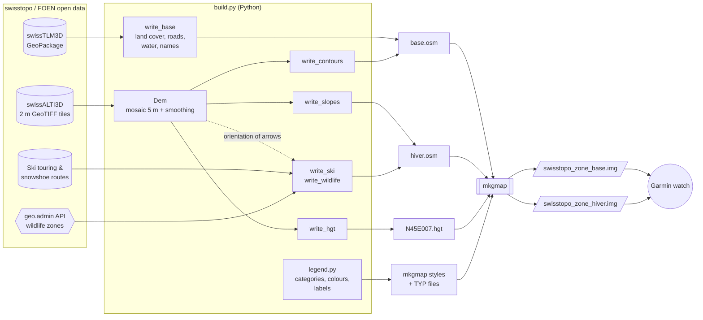

# swisstopo-garmin

Build lightweight **vector maps for Garmin watches and handhelds** (tested target: fēnix 7X Pro) from the
**free geodata of swisstopo**, with a **winter overlay** for ski touring: slope classes over 30°,
ski touring and snowshoe routes, and wildlife quiet zones.

It was written for mountain leaders of the Swiss Alpine Club (SAC/CAS), who need a map that sticks to the
Swiss national map content in summer as well as in winter.

| Map | Content | When to enable it |
|---|---|---|
| `swisstopo_<zone>_base.img` | Contour lines (10/50/100 m), rock, scree, glaciers, forest, water, buildings, roads, paths with the Swiss hiking colours (yellow / red / blue), aerial ropeways, summits with elevation, passes, huts, place names, hill shading | All year |
| `swisstopo_<zone>_hiver.img` | Transparent overlay: slope classes 30-35° / 35-40° / 40-45° / > 45°, ski touring network with uphill/downhill arrows, "on foot" and "increased caution" sections, route numbers with SAC grade, snowshoe routes, wildlife quiet zones and protection areas with their allowed routes | Winter |

Vector maps are much smaller than raster maps of the same area and stay sharp at every zoom level.

> ⚠️ **Safety.** The slope layer is computed from the terrain model and does not replace the avalanche
> bulletin, the official maps or your own judgement in the field. Check the quiet zones and their dates on
> [map.geo.admin.ch](https://map.geo.admin.ch) before each trip.

---

## How it works



1. **`download.py`** fetches the datasets from the swisstopo STAC API: only the swissALTI3D tiles that
   cover the area, the full swissTLM3D and the route datasets. It also fetches **mkgmap**, the open-source
   Garmin map compiler. Downloads resume if interrupted.
2. **`build.py`** reads everything within the area bounding box (Swiss LV95 coordinates), converts it to
   **OSM XML** in WGS84, and tags each object with a single key `k=<category>`.
   - The terrain model is resampled to 5 m and lightly smoothed. It feeds the contour lines, the slope
     classes, the `.hgt` file for hill shading, and the orientation of the ski arrows (each arrowed
     segment is reoriented uphill or downhill).
   - Wildlife zones come live from the geo.admin API; the routes allowed inside them are kept as well.
3. **`legend.py`** is the single source of truth for the look of the maps. For every category it holds
   the Garmin type, the zoom level, the colours or bitmap pattern, and the legend labels in FR/DE/IT/RM/EN.
   From it, the build writes the **mkgmap style** (which `k=` goes to which Garmin type) and the
   **TYP file** (how the device draws each type).
4. **mkgmap** compiles the base map, with its digital elevation model for hill shading, and the winter
   overlay, which is marked *transparent* with a higher draw priority. The result is one `.img` file per
   map.

### Files

| File | Role |
|---|---|
| `config.py` | Settings: paths and options from `.env`, areas (`ZONES`), Garmin identifiers, dataset URLs |
| `download.py` | Downloads swissALTI3D tiles, swissTLM3D, ski/snowshoe routes and mkgmap |
| `build.py` | Pipeline: terrain model, contours, slopes, base data, winter data, `.hgt`, mkgmap call |
| `legend.py` | Map legend: Garmin types, zoom levels, colours/patterns, translated labels; generates style and TYP |
| `osmwriter.py` | Writes shapely geometries (LV95) to OSM XML (WGS84), including multipolygons with holes |
| `.env.example` | Template of the local configuration (copy to `.env`) |
| `requirements.txt` | Python dependencies |

Data stays outside the repository, in `DATA_DIR`:

```
DATA_DIR/
├── download/   raw datasets (≈ 16 GB with swissTLM3D unzipped)
├── work/<zone>/ intermediate OSM, hgt, generated style and TYP, mkgmap output
└── output/     final .img files
```

---

## Installation

Requirements: **Python ≥ 3.11**, **Java ≥ 11** (for mkgmap), about **20 GB** of free disk space and an
internet connection.

```powershell
git clone <this repository>
cd swisstopo-garmin
python -m venv .venv
.venv\Scripts\activate            # Linux/macOS: source .venv/bin/activate
pip install -r requirements.txt
copy .env.example .env           # Linux/macOS: cp .env.example .env
```

Edit `.env`:

| Variable | Meaning | Default |
|---|---|---|
| `DATA_DIR` | Where data is downloaded and processed. Keep it out of OneDrive/Dropbox. | `~/swisstopo-data` |
| `OUTPUT_DIR` | Where the final `.img` files go | `$DATA_DIR/output` |
| `TOOLS_DIR` | Where mkgmap is unpacked | `./tools` |
| `JAVA_EXE` | Java executable, if `java` is not in the PATH | `java` |
| `JAVA_MAX_HEAP` | Memory for mkgmap | `4g` |
| `ZONE` | Area to build, one of the keys of `ZONES` in `config.py` | `telliers` |
| `LANG_LABELS` | Language of the labels: `fr`, `de`, `it`, `rm` or `en` | `fr` |

### Build

```powershell
python download.py        # first run: ≈ 5 GB download, resumable
python build.py           # ≈ 1 min for the test area
```

Options:

```powershell
python build.py --no-dem          # no hill shading (smaller map)
python build.py --step osm        # only the intermediate data
python build.py --step mkgmap     # only the compilation (after editing legend.py, for example)
```

The maps are written to `OUTPUT_DIR`, for example `swisstopo_telliers_base.img` and
`swisstopo_telliers_hiver.img`.

### Adding an area

Add an entry to `ZONES` in `config.py`, with the bounding box in LV95 metres (read the coordinates on
[map.geo.admin.ch](https://map.geo.admin.ch)). Then set `ZONE` in `.env` and run `download.py` (it fetches
the missing elevation tiles) and `build.py`:

```python
ZONES = {
    "telliers": (2_574_000, 1_079_000, 2_584_000, 1_088_000),
    "arolla":   (2_600_000, 1_088_000, 2_612_000, 1_100_000),
}
```

### Labels and languages

- **Legend** (category names shown by the device): the TYP file contains French, German, Italian and
  English, and the watch picks the one matching its language. `LANG_LABELS` sets the fallback string,
  which is the only place Romansh can be used.
- **Data labels** (SAC grade of routes, type of allowed route in a wildlife zone) follow `LANG_LABELS`.
  The sources have no Romansh version, so `rm` falls back to German.
- **Place names** always keep their official local form from swissTLM3D.

---

## Installing the maps on a Garmin watch

The steps below are for a **fēnix 7 / 7 Pro**. Other recent Garmin devices (Epix, Forerunner with maps,
eTrex, GPSMAP…) work the same way, with slightly different menu names.

### 1. Copy the files

1. Connect the watch to the computer with its USB cable.
2. Open the device storage:
   - **Windows**: in the File Explorer, the watch appears under *This PC* as `fēnix 7X Pro` (MTP device,
     no drive letter). Open `Internal Storage`.
   - **macOS**: install [OpenMTP](https://openmtp.ganeshrvel.com/) (Garmin Express does not copy custom
     maps) and open the watch storage.
   - **Linux**: the watch is mounted through MTP (gvfs/`jmtpfs`).
3. Copy the `.img` files into the **`GARMIN`** folder at the root of the storage:
   ```
   Internal Storage/
   └── GARMIN/
       ├── swisstopo_telliers_base.img
       └── swisstopo_telliers_hiver.img
   ```
   Keep distinct file names. Do **not** rename the files `gmapsupp.img`, which could overwrite another map.
4. Eject the watch properly and unplug it. It scans the new maps on restart, which can take a few
   seconds.

### 2. Enable the maps

On the watch: hold **MENU** → **Map** → **Map Manager** (called **Configure Maps** on some firmware).

- Enable **Swisstopo CAS base \<zone\>**.
- Disable the Garmin maps (TopoActive) of the same area. Otherwise both are drawn on top of each other.
- In winter, also enable **Swisstopo CAS hiver \<zone\>**. In summer, disable it.

Recommended map settings (hold **MENU** → **Map**):

| Setting | Value | Why |
|---|---|---|
| Map Theme | **None** | Other themes replace the colours of the TYP file |
| Detail | **More** or **Most** | Shows the 10 m contour lines and the small paths earlier |
| Relief Shading | **On** | Uses the elevation model embedded in the base map |
| Orientation | to taste (North up is closest to a paper map) | |

### 3. Summer / winter per activity

Each activity profile can have its own map selection. In the activity menu (for example *Ski Touring* /
*Backcountry Ski*): **Settings** → **Map** → turn off **Use System Settings** → **Map Manager** /
**Configure Maps** → enable the winter overlay. Do the same in *Hike* / *Mountaineering* with the overlay
disabled.

This way the watch switches between the summer and winter maps by itself, depending on the activity you
start.

### 4. Updating or removing

To update a map, overwrite the `.img` files in `GARMIN` with the new versions; to remove it, delete them.
A new version of the data (swissTLM3D is published every year, the ski routes several times a season)
only requires running `download.py` and `build.py` again.

### Troubleshooting

| Symptom | Cause / fix |
|---|---|
| The map does not appear in the Map Manager | File outside the `GARMIN` folder, or watch not restarted. Check the extension is `.img`. |
| Colours look like the Garmin map | Map Theme not set to *None*, or TopoActive still enabled on top |
| Slope stipple hides the terrain | Disable the winter overlay, or change `STIPPLE` in `legend.py` to a sparser pattern |
| No 10 m contour lines or labels | They only appear at the closest zoom levels; set Detail to *More* or *Most* |
| The overlay hides the base map | The base map was built transparent, or both maps have the same family id: keep `FAMILY_ID` and `FAMILY_ID + 1` unique |

---

## Data sources and licences

The **code** is licensed under the [GNU GPL v3 or later](LICENSE): you may use, modify and share it
freely, but modified versions you distribute must be published under the same licence, with their
source code.

The **generated maps** contain third-party data with their own terms. Keep the attribution when you
share them:

| Data | Provider | Terms |
|---|---|---|
| swissTLM3D, swissALTI3D | © swisstopo | [Open Government Data, free use with attribution](https://www.swisstopo.admin.ch/en/terms-of-use-free-geodata-and-geoservices) |
| Ski touring and snowshoe routes | © swisstopo, with the Swiss Alpine Club SAC | Same terms |
| Wildlife quiet zones, wildlife protection areas | © FOEN / BAFU, cantons | [geo.admin.ch terms of use](https://www.geo.admin.ch/en/general-terms-of-use-fsdi) |
| mkgmap (map compiler, not redistributed) | mkgmap contributors | GPL v2 |

This project is not affiliated with swisstopo, the FOEN or the Swiss Alpine Club.

---

## Limitations and ideas

- **All of Switzerland in one map** is not supported yet: it needs to be cut into tiles with
  [splitter](https://www.mkgmap.org.uk/download/splitter.html) before mkgmap.
- swissALTI3D only covers Switzerland: near the borders, contours, slopes and hill shading stop at the
  border.
- Hill shading and the half-transparent slope patterns depend on the device firmware; they still have to
  be validated on the fēnix 7X Pro.
- The Romansh legend labels are a first draft and need proofreading by a native speaker.
